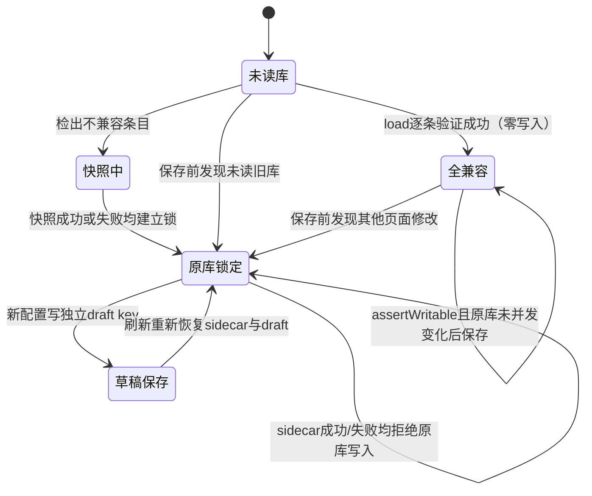

# TASK-013 交付报告（round 0）

契约：ACTIVE TASK-013，SHA-256 `12046dc7f1450a49ff620bd2c4404e98f196523da08a8af141a98faca526483b`。
实现基线：`09be0e0f238fc44c7ff0498469da6d863390ce21`（WorkBuddy 文档与交接补全，承接 TASK-012 APPROVED）。

## 结果

- **265 tests / 265 passed / 0 failed / 0 skipped**。原 70 失败逐项关闭；既有用例无缺失，只有两个官方 Dem 用例标题按真实新语义改名。
- `npm run build` 通过：vue-tsc 严格检查 + Vite 生产构建，12.26s。现有主包大小告警仍在，不宣称已完成 S7 性能验收。
- **`src/core/**` 零改动**；没有改 namespace、输出闸门、迁移、旧库锁或阶段字段。
- S1 recovery **15/15** 保持全绿，测试文件未改。GCC 实际编译检查通过，无环境 skip。

## 交付对照

| 编号 | 文件 / 完成内容 |
|---|---|
| A1 | `tests/fixtures/synthetic-dem.json` + README：固定小型行为模型，与官方 4.4.0 定义分开。`io` / `lifecycle` / `editor` / `editor-ui` / `io-ui` / `ui` / `replica` / `arxml-editor` 用真实业务代码执行合成输入。官方 `core` / `ecuc*` / `choice*` / `recovery` 保留真实定义，`arxml-fidelity` 官方 Dem 区块按官方结构重建。 |
| A2 | 所有活动 `legacy()` 调用和 helper 加载入口移除。合成 STRING 使用 `fixture-text-payload` / `FixtureText`，BOOLEAN 使用 `fixture-toggle` / `FixtureToggle`；无 J1939→Severity 或 ImmediateNv→AgingAllowed 替换。历史 `legacy-map.json` 保留证据但不加载。准确历史恢复测试仍验证原字段/原值。 |
| A3 | `TASK-013-SEMANTIC-AUDIT.md`：70 项失败逐条闭合 + 每个发生文本变化的 expect 表达式新旧对照 + 特殊语义说明。`evidence/task013/test-summary.json` 包含全名映射、旧用例零缺失核验、恢复与编译结果、原始报告 SHA-256。 |
| A4 | 见下方真实缺陷清单。未用修改产品或放宽断言掩盖；S2 未修 core 缺陷，继续交 S3 契约处理。 |
| A5 | `src/stores/configStore.ts`：原始导出包新增 `readme`，分别解释 rawJson / recoveryState / draftLibrary；sidecar 写失败告警补“请先导出原始数据，再关闭页面”。原始数据内容与拒写机制不变。 |
| A6 | 本报告提供存储状态机要点，供 WorkBuddy 维护 02-TECH-DESIGN；未自行修改其架构文档。 |

## 测试修正的关键语义

1. 合成模型明确版本 `TEST-SYNTHETIC-1`，7 容器/31 参数、15 已确认必填输出/16 未配置状态的旧数量断言继续验证原行为，**不用于宣称官方 Dem 的字段数量**。模型保留 Dem 名称仅让现有 Dem 插件参加集成测试；UUID 换为 fixture-*，不与官方 UUID 关联。
2. 官方 Dem 仍为 67 定义。初始化树含 50 参数，加一个 DTC 为 55。DTC 的 5 参数（含 Severity）在官方定义中是可选；原先硬判 Severity 必填错误，现逐条检查全部真实必填路径。显式 false 用 DemGeneral/DemDevErrorDetect 验证，只有一个字段确认时仍拒绝其余必填，确认真实必填后核对 VALUE 数、path、false、flags、整树和时间戳往返。
3. NvM CHOICE 在 TASK-009 已支持，旧“完全不能输出 CHOICE”预期撤销；保留空必选 CHOICE 拒绝、候选列表、跨模块引用警告，并强化 candidateRefs 和无模块级阻断列表断言。未声称跨模块引用已可解析。
4. `io-ui` 的“空目标库”用例原本只新建 Pinia、仍留有旧内存存储。S1 正确拒绝覆盖未读库。修正仅清空**测试内存 mock**，明确构造空目标库，完整相等/刷新断言不变。
5. 子定义选择器测试改用现有 `.child-option-name` 定位行，再检查“添加”按钮禁用和上限理由。S4 的右键交互修改尚未混入本轮。
6. 性能断言仍为固定合成规模 20 步撤销 <500ms、500 实例搜索 ≤200ms，不调大阈值。这是测试环境回归，不替代 S7 真实浏览器大规模测量。

## 真实缺陷与后续阶段

| 项 | 证据 / 本轮处理 | 后续 |
|---|---|---|
| JSON 定义解析丢失部分路径/模块来源元数据 | 官方 raw 中参数 `definitionPath` 存在，BswmdParser 的 identity/参数返回值未保留；本轮官方输出测试直接与 raw 中精确路径比较，当前 Dem 在标准层级下能重建正确路径。此通过不能外推到任意非默认包路径。 | S3 G17：保留真实路径，并加非默认包路径往返回归；S5 来源展示不能依赖已被剥离元数据。 |
| 校验与输出的必填/已配置判据仍分离 | 既有 G03/L08 已记录，S2 只确认当前 ARXML 的必填拒绝与未配不输出行为。 | S3 单一输出闸门，保留 JSON/整库备份取回能力。 |
| 现有 namespace 仍为 r4.2.2 | 本轮依契约未改。通过的是当前语法/保真回归，不宣称符合 CP4.4.0 命名空间或完成 XSD 验证。 | S3 改为 r4.0，显式兼容旧文件。 |
| 原右键横排/叠层、多模块整体输出 | 已提交用户证据，并由 WorkBuddy 在 `09be0e0` 更新 W6 / ADR-11 / 阶段计划。 | S4 右键子菜单；S5 前置多模块并存、批量定义提取与 manifest 输出。 |

## 存储状态机要点（A6，供评审方并入设计）

原库唯一写点仍在 persistLibrary；草稿有独立并发检查；原始导出在任何锁定/校验状态均可取回。S6 以前不存在解锁覆盖原库路径。

## 验证原文与证据

- 最终完整原文：`.temp/task013-final-tests.json`（本机供独立复核），摘要与 SHA-256：`evidence/task013/test-summary.json`。
- 构建原文：`.temp/task013-build.log`，可提交摘录：`evidence/task013/build.log`。
- 基线原文：`.temp/wb-review-tests.json`（WorkBuddy 独立运行，265 = 195 pass + 70 fail）。
- 失败差分：旧 70 项在最终报告均 passed；旧 265 用例（含两项语义准确的标题更名）零缺失。
- `git diff --check` 通过；core 差分为空；活动 TypeScript 测试无 legacy() 调用、无 legacy-map 加载。
- 本阶段主要是自动化测试重建；两处说明文案不新增浏览器功能。本轮不虚报新的子菜单、多模块业务、供应商互操作或 XSD 验收。

## 未完成与限制

S3–S7 尚待分阶段实现/评审。TASK-013 全绿表示测试基线恢复可信，**不等于产品最终可交付**。用户真实数据未被测试脚本修改，新增合成定义仅供测试使用。
